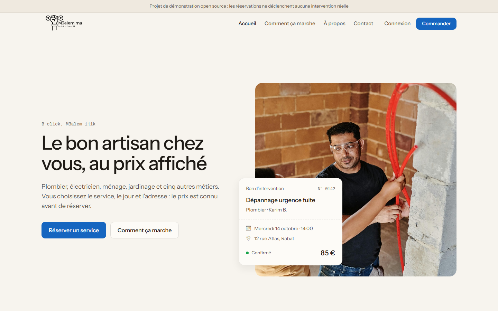
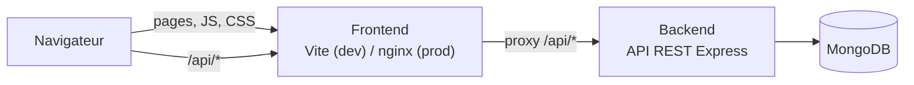

# M3alem.ma

> **B Click M3alem Ijik** — réservez un professionnel de confiance pour votre maison en quelques clics.

[](https://github.com/MEDAMINEJAANANE21/m3alem/actions/workflows/ci.yml)
[](LICENSE)


🇬🇧 [Read in English](README.md)

M3alem.ma est une marketplace open source qui met en relation des clients et des professionnels
du service à domicile au Maroc : plombiers, électriciens, techniciens climatisation, ménage,
jardiniers, serruriers, menuisiers, lavage auto et mécaniciens.



## Fonctionnalités

- **Catalogue de services** par catégorie, avec prix fixe, à l'heure ou à l'unité
- **Panier et réservation** : date, adresse, plusieurs services en une fois
- **Comptes avec rôles** : `client`, `prestataire` et `admin`, sécurisés par JWT
- **Cycle de réservation** : `pending → confirmed → completed` (ou `cancelled`), contrôlé par l'API
- **Page « Mon compte »** : le client suit ses réservations, le prestataire les confirme
- **Avis clients** enregistrés dans MongoDB
- **Formulaire de contact** (via [Web3Forms](https://web3forms.com))

## Architecture



Le navigateur ne parle qu'au **frontend**. Chaque requête `/api` est transmise par un **proxy**
(Vite en développement, nginx en production) au **backend**. Pas de CORS à configurer, pas d'URL
d'API écrite en dur dans le client.

| Partie   | Technologies                                                                    |
| -------- | ------------------------------------------------------------------------------- |
| Frontend | HTML, CSS, JavaScript natif (modules ES), Bootstrap 5, Vite                     |
| Backend  | Node.js, Express 5, Mongoose 8, JWT, express-validator, helmet, rate limiting   |
| Base     | MongoDB                                                                         |
| Outils   | npm workspaces, ESLint, Prettier, node:test + supertest, Docker, GitHub Actions |

Détails : [docs/ARCHITECTURE.md](docs/ARCHITECTURE.md). API : [docs/API.md](docs/API.md).
Mise en ligne gratuite (Atlas + Render) : [docs/DEPLOYMENT.md](docs/DEPLOYMENT.md).

## Démarrage

### Prérequis

- [Node.js](https://nodejs.org) **22.9 ou plus récent**
- [MongoDB](https://www.mongodb.com/try/download/community) en local, dans Docker
  (`docker run -d -p 27017:27017 mongo:7`) ou un cluster gratuit [MongoDB Atlas](https://www.mongodb.com/atlas)

### Installation

```bash
git clone https://github.com/MEDAMINEJAANANE21/m3alem.git
cd m3alem
npm install

# Configurer l'API
cp backend/.env.example backend/.env   # puis renseigner JWT_SECRET (et MONGODB_URI si besoin)

# Optionnel : charger le catalogue et les comptes de démo
npm run seed

# Lancer l'API (port 3000) et le frontend (port 5173) ensemble
npm run dev
```

Ouvrir **http://localhost:5173**.

### Comptes de démo

Créés par `npm run seed` (mot de passe : `Password123!`, ou `SEED_PASSWORD` du `.env`) :

| Rôle        | E-mail                |
| ----------- | --------------------- |
| Client      | `client@m3alem.local` |
| Prestataire | `pro@m3alem.local`    |
| Admin       | `admin@m3alem.local`  |

### Avec Docker

Toute la stack (frontend, API, MongoDB et une interface pour la base) se lance en une commande.
Seul [Docker](https://www.docker.com/products/docker-desktop/) est nécessaire.

```bash
cp .env.example .env            # puis renseigner JWT_SECRET
docker compose up -d --build    # construit et démarre tout
docker compose --profile seed up seed   # optionnel : données de démo
```

| Service       | URL                                | Ce que vous voyez                              |
| ------------- | ---------------------------------- | ---------------------------------------------- |
| Frontend      | http://localhost:8080              | Le site (nginx, qui transmet `/api`)           |
| Backend       | http://localhost:3000/api/health   | L'API REST, appelée directement                |
| mongo-express | http://localhost:8081              | Parcourir la base (identifiants `admin/admin`) |
| MongoDB       | `mongodb://localhost:27017/m3alem` | Connexion avec MongoDB Compass                 |

Un port est déjà pris sur votre machine ? Changez `FRONTEND_PORT`, `API_PORT`,
`MONGO_EXPRESS_PORT` ou `MONGO_PORT` dans `.env`. Seul le frontend est accessible depuis
d'autres appareils : l'API, la base et son interface écoutent uniquement sur `127.0.0.1`.

Commandes utiles : `docker compose logs -f backend`, `docker compose down` (arrêter),
`docker compose down -v` (arrêter et supprimer la base).

## Scripts

À lancer depuis la racine :

| Commande         | Rôle                                                  |
| ---------------- | ----------------------------------------------------- |
| `npm run dev`    | Lance l'API et le serveur Vite (avec proxy)           |
| `npm run build`  | Compile le frontend dans `frontend/dist`              |
| `npm start`      | Lance l'API en mode production                        |
| `npm run seed`   | Réinitialise la base avec les données de démo         |
| `npm test`       | Tests de l'API (MongoDB en mémoire, rien à installer) |
| `npm run lint`   | Analyse le code avec ESLint                           |
| `npm run format` | Formate le code avec Prettier                         |

## Organisation du code

Voir la section « Project structure » du [README anglais](README.md#project-structure).
Les fichiers suivent la convention `<fonctionnalité>.<type>.js` (ex. `auth.controller.js`,
`session.store.js`) : voir [CONTRIBUTING.md](CONTRIBUTING.md#naming-conventions).

## Contribuer

Les contributions sont les bienvenues ! Lisez [CONTRIBUTING.md](CONTRIBUTING.md) et le
[Code de conduite](CODE_OF_CONDUCT.md). Pour signaler une faille : [SECURITY.md](SECURITY.md).

## Licence

[MIT](LICENSE) © 2025 JAANANE

Les photos et illustrations de `frontend/public/img` sont fournies pour la démonstration. Leur
origine n'a pas été documentée : vérifiez leur licence avant tout usage commercial.
