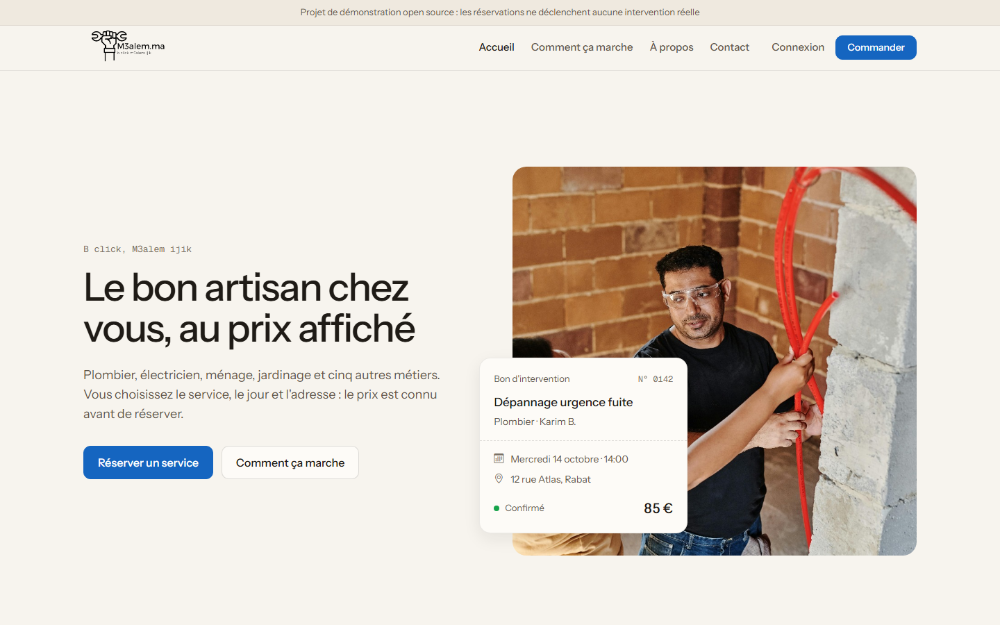
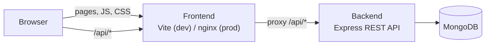

# M3alem.ma

> **B Click M3alem Ijik** — book a trusted home-service professional in a few clicks.

[](https://github.com/MEDAMINEJAANANE21/m3alem/actions/workflows/ci.yml)
[](LICENSE)


🇫🇷 [Lire en français](README.fr.md)

M3alem.ma is an open-source marketplace that connects customers with home-service professionals
in Morocco: plumbers, electricians, air-conditioning technicians, cleaners, gardeners, locksmiths,
carpenters, car washers and mechanics.



## Features

- **Service catalog** grouped by category, with fixed, hourly and per-unit pricing
- **Cart and booking** — pick a date, an address, and book several services at once
- **Accounts with roles** — `client`, `prestataire` (provider) and `admin`, secured with JWT
- **Booking workflow** — `pending → confirmed → completed` (or `cancelled`), enforced by the API
- **"My account" page** — clients follow their bookings, providers confirm and complete them
- **Customer reviews** stored in MongoDB
- **Contact form** (via [Web3Forms](https://web3forms.com))

## Architecture



The browser only talks to the **frontend**. Every `/api` request is forwarded by a **proxy**
(Vite in development, nginx in production) to the **backend**. No CORS setup, no API URL
hard-coded in the client.

| Part     | Stack                                                                           |
| -------- | ------------------------------------------------------------------------------- |
| Frontend | HTML, CSS, vanilla JavaScript (ES modules), Bootstrap 5, Vite                   |
| Backend  | Node.js, Express 5, Mongoose 8, JWT, express-validator, helmet, rate limiting   |
| Database | MongoDB                                                                         |
| Tooling  | npm workspaces, ESLint, Prettier, node:test + supertest, Docker, GitHub Actions |

More details in [docs/ARCHITECTURE.md](docs/ARCHITECTURE.md). The REST API is documented in
[docs/API.md](docs/API.md). To put the site online for free (Atlas + Render), follow
[docs/DEPLOYMENT.md](docs/DEPLOYMENT.md).

## Getting started

### Prerequisites

- [Node.js](https://nodejs.org) **22.9 or newer**
- [MongoDB](https://www.mongodb.com/try/download/community) running locally, in Docker
  (`docker run -d -p 27017:27017 mongo:7`) or a free [MongoDB Atlas](https://www.mongodb.com/atlas) cluster

### Install and run

```bash
git clone https://github.com/MEDAMINEJAANANE21/m3alem.git
cd m3alem
npm install

# Configure the API
cp backend/.env.example backend/.env   # then set JWT_SECRET (and MONGODB_URI if needed)

# Optional: load the demo catalog and demo accounts
npm run seed

# Start the API (port 3000) and the frontend (port 5173) together
npm run dev
```

Open **http://localhost:5173**.

### Demo accounts

Created by `npm run seed` (password: `Password123!`, or `SEED_PASSWORD` from `.env`):

| Role     | E-mail                |
| -------- | --------------------- |
| Client   | `client@m3alem.local` |
| Provider | `pro@m3alem.local`    |
| Admin    | `admin@m3alem.local`  |

### Run with Docker

Run the whole stack (frontend, API, MongoDB and a database UI) with one command — only
[Docker](https://www.docker.com/products/docker-desktop/) is required.

```bash
cp .env.example .env            # then set JWT_SECRET
docker compose up -d --build    # build and start everything
docker compose --profile seed up seed   # optional: load the demo data
```

| Service       | URL                                | What you see                              |
| ------------- | ---------------------------------- | ----------------------------------------- |
| Frontend      | http://localhost:8080              | The website (nginx, proxies `/api`)       |
| Backend       | http://localhost:3000/api/health   | The REST API, called directly             |
| mongo-express | http://localhost:8081              | Browse the database (login `admin/admin`) |
| MongoDB       | `mongodb://localhost:27017/m3alem` | Connect with MongoDB Compass              |

A port is already used on your machine? Change `FRONTEND_PORT`, `API_PORT`, `MONGO_EXPRESS_PORT`
or `MONGO_PORT` in `.env`. Only the frontend is reachable from other devices; the API, the database
and its UI listen on `127.0.0.1` only.

Useful commands: `docker compose logs -f backend`, `docker compose down` (stop),
`docker compose down -v` (stop and delete the database).

## Scripts

Run from the repository root:

| Command          | Description                                        |
| ---------------- | -------------------------------------------------- |
| `npm run dev`    | Start the API and the Vite dev server (with proxy) |
| `npm run build`  | Build the frontend into `frontend/dist`            |
| `npm start`      | Start the API in production mode                   |
| `npm run seed`   | Reset the database with demo data (not in prod)    |
| `npm test`       | Run the API tests (in-memory MongoDB, no setup)    |
| `npm run lint`   | Lint the code with ESLint                          |
| `npm run format` | Format the code with Prettier                      |

## Project structure

```text
m3alem/
├── backend/                 Express REST API
│   ├── src/
│   │   ├── config/          Environment & database configuration
│   │   ├── constants/       Roles, categories, booking statuses
│   │   ├── controllers/     HTTP handlers (one per resource)
│   │   ├── errors/          ApiError
│   │   ├── middlewares/     Auth, validation, rate limiting, errors
│   │   ├── models/          Mongoose schemas
│   │   ├── routes/          Express routers
│   │   ├── services/        Business services (JWT tokens)
│   │   ├── utils/           Small helpers
│   │   ├── validators/      express-validator rules
│   │   ├── app.js           Express app factory
│   │   └── server.js        Entry point
│   ├── scripts/             Seed script and demo data
│   └── tests/               API integration tests
├── frontend/                Web client (Vite multi-page app)
│   ├── *.html               Pages
│   ├── public/img/          Static images
│   ├── src/
│   │   ├── api/             HTTP client and API facade
│   │   ├── components/      Shared header/footer
│   │   ├── config/          Frontend configuration
│   │   ├── pages/           One script per page
│   │   ├── stores/          Session and cart state
│   │   ├── styles/          Global and per-page CSS
│   │   └── utils/           DOM, formatting, storage helpers
│   ├── nginx.conf           Production web server + API proxy
│   └── vite.config.js       Dev server + API proxy
├── docs/                    Architecture and API documentation
└── docker-compose.yml       Full stack: nginx + API + MongoDB
```

Files follow the `<feature>.<type>.js` naming convention (for example `auth.controller.js`,
`session.store.js`). See [CONTRIBUTING.md](CONTRIBUTING.md#naming-conventions).

## Roadmap

Ideas for contributors — feel free to open an issue before starting:

- [ ] Provider dashboard to create and edit services from the UI (the API already supports it)
- [ ] Admin dashboard (users, services, reviews moderation)
- [ ] Prices in Moroccan dirham (MAD) and online payment
- [ ] Arabic and Darija translations
- [ ] E-mail / SMS notifications when a booking changes status
- [ ] End-to-end browser tests

## Contributing

Contributions are welcome! Please read [CONTRIBUTING.md](CONTRIBUTING.md) and our
[Code of Conduct](CODE_OF_CONDUCT.md). To report a vulnerability, see [SECURITY.md](SECURITY.md).

## License

[MIT](LICENSE) © 2025 JAANANE

The photos and illustrations in `frontend/public/img` are included for demonstration only. Their
origin was not documented: check their license before any commercial use.
