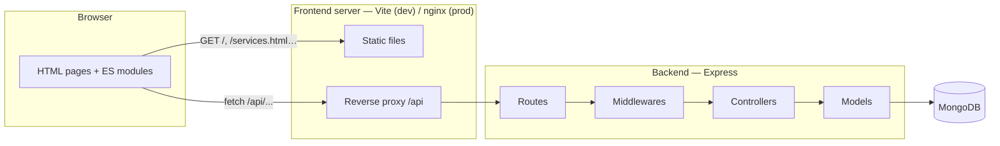

# Architecture

This document explains how M3alem.ma is organised and why.

## Overview

The repository is an **npm workspaces monorepo** with two independent applications:

| Workspace   | Role                                         | Dev port | Production        |
| ----------- | -------------------------------------------- | -------- | ----------------- |
| `frontend/` | Static multi-page web client (Vite)          | 5173     | nginx (port 80)   |
| `backend/`  | Stateless JSON REST API (Express + Mongoose) | 3000     | Node.js container |



## Frontend ↔ backend: the proxy

The browser only ever talks to **one origin** (the frontend). Requests to `/api/*` are forwarded
to the backend by a reverse proxy:

- **development** — Vite `server.proxy` in [`frontend/vite.config.js`](../frontend/vite.config.js)
  (target configurable with `API_PROXY_TARGET`);
- **production** — nginx `location /api/` in [`frontend/nginx.conf`](../frontend/nginx.conf).

Benefits:

1. **No CORS**: the API is same-origin from the browser's point of view.
2. **No hard-coded API URL** in the client: it always calls `/api`.
3. **Independent deployments**: the frontend and the API can be scaled or replaced separately.

Because nginx sits in front of the API, the backend sets Express `trust proxy` (`TRUST_PROXY=1`),
so the rate limiter sees the real client IP from `X-Forwarded-For`.

## Backend

### Request lifecycle

```text
HTTP request
  → helmet, morgan, express.json          (app.js)
  → /api router                           (routes/api.router.js)
  → rate limiter                          (middlewares/rate-limit.middleware.js)
  → authenticate / authorize              (middlewares/auth.middleware.js)
  → validate(rules)                       (middlewares/validate.middleware.js + validators/)
  → controller                            (controllers/)
  → Mongoose model                        (models/)
  → JSON response
  ↘ any thrown error → errorHandler       (middlewares/error.middleware.js)
```

### Layers

| Folder         | Responsibility                                                            |
| -------------- | ------------------------------------------------------------------------- |
| `config/`      | Read and validate environment variables; connect to MongoDB               |
| `constants/`   | Single source of truth for roles, categories and booking statuses         |
| `routes/`      | Map URLs to middleware chains and controllers — no logic                  |
| `middlewares/` | Cross-cutting concerns: authentication, authorization, validation, errors |
| `validators/`  | Declarative input rules (express-validator)                               |
| `controllers/` | Use cases: read validated input, call models, shape the response          |
| `models/`      | Mongoose schemas and domain methods (e.g. `Service#computeTotal`)         |
| `services/`    | Technical services shared by controllers (JWT signing/verification)       |
| `errors/`      | `ApiError`, the only error type controllers throw on purpose              |

Controllers only read `req.validated`, which contains **only** fields that passed validation. This
prevents mass-assignment (for example a client sending `"role": "admin"` or `"totalPrice": 1`).

### Error format

Every error response has the same shape:

```json
{
  "error": {
    "message": "Données invalides",
    "details": [{ "field": "email", "message": "Adresse e-mail invalide" }]
  }
}
```

## Frontend

The frontend is a **multi-page app** without a framework: each HTML page loads one ES module from
`src/pages/`.

| Folder        | Responsibility                                                           |
| ------------- | ------------------------------------------------------------------------ |
| `api/`        | `http.client.js` (fetch wrapper, JWT header, errors) and `api.client.js` |
| `stores/`     | Shared state: `session.store.js` (JWT + user) and `cart.store.js`        |
| `components/` | `layout.component.js` renders the header and footer of every page        |
| `pages/`      | One controller script per HTML page                                      |
| `utils/`      | DOM builder (`el`), formatting, safe `localStorage` access               |
| `styles/`     | `base.css` (design tokens), `layout.css`, one stylesheet per page        |

User-provided content is always inserted with `textContent` (through the `el()` helper), never
with `innerHTML`, which prevents XSS.

## Design patterns

Patterns are named in the code where they are used (vocabulary from
[Refactoring.Guru](https://refactoring.guru/design-patterns)).

| Pattern                     | Where                                                              | Why                                                |
| --------------------------- | ------------------------------------------------------------------ | -------------------------------------------------- |
| **Factory**                 | `createApp(config)`, `createXRouter(deps)`, `createTokenService()` | Build objects from injected config — easy to test  |
| **Chain of Responsibility** | Express middleware chains                                          | Each step (auth, validation…) handles or passes on |
| **Strategy**                | `BOOKING_SCOPE_BY_ROLE` (backend), `ACTIONS_BY_ROLE` (frontend)    | Behaviour chosen by role without `if/else` chains  |
| **Facade**                  | `frontend/src/api/api.client.js`                                   | Pages call `apiClient.login()`, never build URLs   |
| **Observer**                | `Observable` base of `session.store.js` and `cart.store.js`        | Header and cart re-render when state changes       |
| **Singleton**               | `session` (frontend)                                               | One session shared by all modules of a page        |
| **Proxy**                   | Vite / nginx `/api` reverse proxy                                  | Single origin for the browser                      |
| **Static factory methods**  | `ApiError.notFound()`, `ApiError.forbidden()`…                     | Readable, consistent HTTP errors                   |

## Security measures

- Passwords hashed with bcrypt; never returned by the API (`select: false` + `toJSON` transform)
- JWT with expiry; expired token → the frontend logs the user out
- Admin accounts cannot be created through sign-up
- Role checks on every protected route; ownership checks on services and bookings
- Prices computed by the server, never trusted from the client
- Booking status changes limited to allowed transitions
- Regex filters escaped (no ReDoS / injection)
- `helmet` on the API, Content-Security-Policy on the pages (nginx)
- Rate limiting on the API, stricter on sign-in/sign-up and public writes
- JSON body size limit (100 kB)

## Testing

`backend/tests/` contains integration tests run with the built-in `node:test` runner and
`supertest`. Each test file starts its own in-memory MongoDB (`mongodb-memory-server`), so tests
need no setup and no external database.
